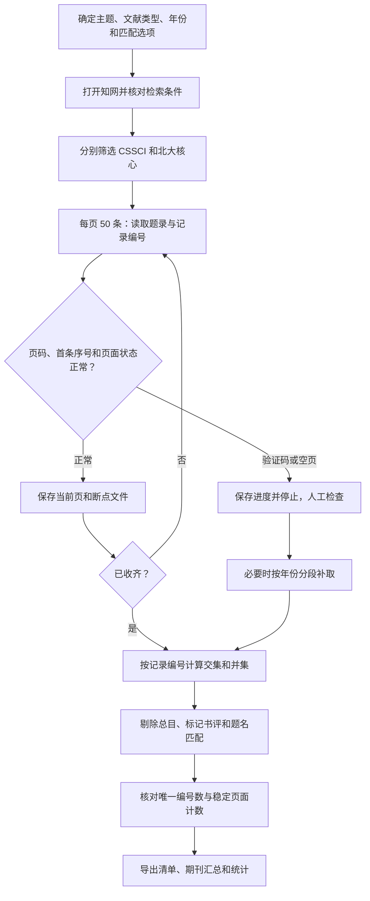

# 知网文献题录采集工作流

从真实的“乡村治理共同体”检索实践整理而来：在浏览器中检索和筛选，用 JavaScript 读取结果列表，检查分页与记录数量，最后按知网记录编号去重、导出阅读清单。

这是一套有人工检查环节的工作流，附浏览器采集模板和可独立运行的离线整理工具。浏览器选择器来自 **2026-11-06** 的实际页面，后续页面结构变化时需要调整。

## 工作流



1. **设定条件**：检索字段、关键词、文献类型、年份、扩展匹配选项均要记录。“主题命中”不等于“题名包含完整短语”。
2. **逐组采集**：未筛来源、CSSCI、北大核心各建一个阶段，记录页面计数和已选来源。采集字段包括篇名、作者、期刊、日期、被引、下载、知网编号和链接。
3. **检查分页**：每次翻页同时检查页码和首条序号，避免把上一页重复保存。每页保存断点；出现验证码、空页、超时或条件变化时停止。
4. **分段补漏**：按年份补取受阻区间，编号去重后检查是否达到原检索范围的数量。不能直接相加不同区间的条数，也不能仅修改 `complete` 标记宣布完成。
5. **合并筛选**：CSSCI 与北大核心取并集。总目排除，书评保留类型标记；“题名含完整词”只是阅读线索。
6. **核对导出**：核对来源集合、交集、并集、排除数和最终清单数；来源筛选完整与全部题录完整分别报告。

## 先运行离线示例

需要 Node.js 20 或以上版本；离线工具没有第三方依赖。

```powershell
git clone https://github.com/zpy1124183005-ux/cnki-literature-workflow.git
cd cnki-literature-workflow
npm test
npm run demo
```

`examples/raw.example.json` 使用虚构的题名、期刊和编号，用于演示去重、分段补取、总目排除和书评标记。输出到 `outputs/demo/`：

| 文件 | 内容 |
| --- | --- |
| `retained.csv` | 来源条件通过、已剔除总目的阅读候选 |
| `journals.csv` | 阅读候选的原始刊名分布 |
| `observed.csv` | 所有已观察记录及来源、类型、阶段标记 |
| `statistics.json` | 计数、完整性检查和待检查事项 |
| `records.json` | 含结构化字段的全部观察记录 |

CSV 使用 UTF-8 BOM，可用 Excel 打开。本仓库的离线工具导出 CSV/JSON；原实践中的三工作表 XLSX 另由表格工具生成，当时依赖本机运行库的 XLSX 脚本未纳入本仓库。

处理自己的断点文件：

```powershell
node scripts/export-results.mjs --input data/raw.json --out outputs/my-search
```

## 在浏览器里采集

原实践以 [cookjohn/cnki-skills](https://github.com/cookjohn/cnki-skills) 的检索、结果解析、翻页及高级筛选流程为参考，通过本机 Tabbit 执行浏览器操作，没有另写知网 HTTP 抓取程序。

本仓库的 [`browser/collect-stage.js`](browser/collect-stage.js) 是从原脚本整理的模板，交给**已经连接当前标签页、提供 `page` 对象的 Tabbit Node.js 执行环境**运行；不要直接 `node browser/collect-stage.js`。其他基于 Playwright 的环境需要自行提供 `page` 并适配执行入口。

1. 在浏览器完成登录和检索，选好学术期刊、年份与来源，设置每页 50 条。
2. 修改脚本顶部 `CONFIG`：关键词、阶段名、完整范围的预期条数、保存路径、实际筛选条件及当前阶段每页条数。
3. 在所需阶段的第一页执行。脚本会读取当前页，最多再翻 `maxNextPages` 页，并保存断点。
4. 同一阶段继续时，保持浏览器在断点最后一页再执行。脚本会核对已存页的编号序列；不能把不同排序、年份或来源的页面拼进同一阶段。
5. 切换来源或年份后修改阶段名。约定 `cssci`、`cssci_*` 属于 CSSCI，`pku`、`pku_*` 属于北大核心，`all` 为未筛来源。
6. 合并来源筛选后，把稳定的联合页面计数写入原始 JSON 的 `unionFilterEvidence.countText`，作为额外复核证据。

脚本会停在验证码或异常页面，保留已采集进度；处理后须重新核对条件再继续。它不自动操作验证码，不收集账号、Cookie，也不下载全文。

## 历史案例与判断边界

完整说明见 [`docs/2026-11-06-case-study.md`](docs/2026-11-06-case-study.md)。当次主题为“乡村治理共同体”，期刊命中 622 条：CSSCI 220 条、北大核心 230 条、交集 188 条，并集 262 条；剔除一条总目后，阅读候选 261 条。实际观察到 390 条唯一题录，不能称为已采集全部 622 条。

- 去重单位是知网记录编号。同一作品的网络首发、正式刊发或文摘转载可能有不同编号，仍需人工核对。
- 来源级别来自当次知网页面筛选，不能直接视为每个历史年份的目录认证。
- 页面没有显示的被引/下载保留为空，不当作零；引用量是采集时的快照。
- 原始发表日期保留页面写法，不替代正式卷期年份。
- 标题、来源和引用量可以帮助筛选，不能直接证明某篇文章是领域开山之作，也不能替代摘要、全文及引用链核查。

## 目录

```text
browser/collect-stage.js           浏览器采集与断点模板
src/records.mjs                    去重、分类和计数逻辑
scripts/export-results.mjs         离线 CSV / JSON 导出入口
examples/raw.example.json          虚构演示数据
test/records.test.mjs              集合、分段、缺失值和导出检查
docs/2026-11-06-case-study.md       真实采集过程和完整性边界
```

原始题录、论文 PDF、Excel、截图、本机路径及浏览器会话文件不随仓库发布。工作流参考来源已在说明中链接；未将第三方技能包复制进仓库。

## 已做验证

2026-11-23 用本地保存的历史原始 JSON 运行离线工具，复现 CSSCI 220、北大核心 230、交集 188、并集 262、阅读候选 261、观察题录 390、原始刊名 144、题名完整短语匹配 69。原始数据及该次输出仍只保存在本地。

`npm test` 覆盖集合去重、分段补取、总目与书评分类、缺失值、同题不同编号、CSV 转义和模板语法。浏览器模板依据历史脚本整理，尚未对当前知网页面重新执行；离线验证通过不代表当前页面选择器已经验证。
